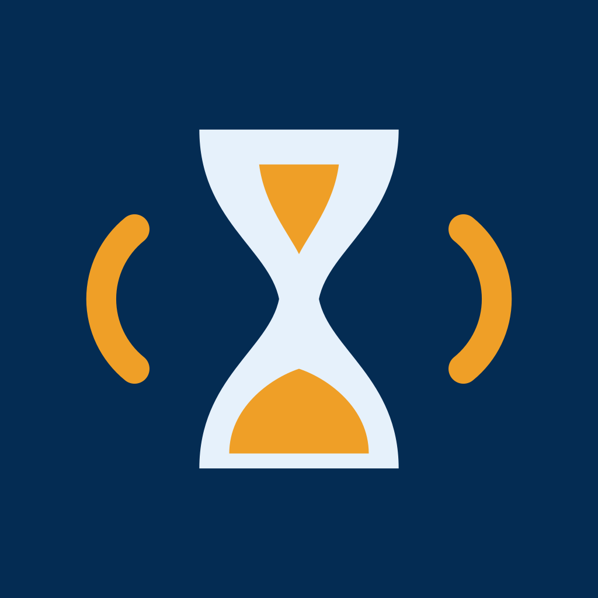
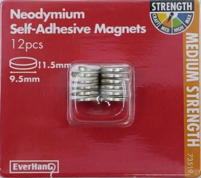

# G7timing



A small Kotlin MultiPlatform app for iPhone and Android.
It's designed to be a monitoring tool for monitoring the BLE broadcasts of Dexcom G7/ONE+/Stelo CGM sensors.


> **Not a medical device.** `G7timing` doesn't read glucose, doesn't start a sensor session, and
> doesn't pair with or sign in to any sensor. Don't use it for treatment decisions. For questions
> about your sensor or therapy, ask your care team.

## How to use the app

The app scans for G7 transmitters. These advertise names that start
with `DXCM`, `DX01` or `DX02`.
G6 transmitters (`Dexcom…`) are ignored. Only transmitters at −99 dBm or stronger are contacted.

There's a `Start`/`Stop` button to control whether the app is scanning for Bluetooth devices.
We can also tell the app to specifically watch for a particular sensor.
Either via:
- The serial number (either typed into a text field, or scanned from the Data Matrix on either the box or the applicator), or
- The 4-digit sensor code shown on the applicator.

**Scan the sensor's applicator or box to pick out its transmitter.** Press **Scan applicator or
box** and point the camera at the square code (a Data Matrix) on the applicator, next to the
4-digit number, or on the sensor's box. As soon as its transmitter next advertises, its card
moves to the top under "This is sensor …4186" (the last 4 digits of its serial number), with a
large counter of the time since it was last seen. Other G7s are tucked behind a "Show other G7s
nearby" button. You can scan before or after pressing Start.

If the code won't scan, or there's no camera, press **Type serial number** and type the serial
number printed on the applicator or box instead (usually 12 digits; spaces and dashes are
ignored). A mistyped digit means the transmitter is never recognised, so check the serial number
shown at the top of the screen against the one printed. The camera is used only for this,
and the serial number is used only to find the transmitter: it's shown in full at the top of the
screen so you can check it against the applicator or box, but it isn't saved or logged.

**Or type the sensor code.** Press **Type sensor code** and type the 4-digit code printed on the
applicator. This replaces any serial number being looked for (and a serial number replaces a code).
Without a serial number, G7timing has to ask each sensor: for every G7 that responds, it runs the
first part of the pairing exchange using the code, which shows whether that sensor uses it, and then
disconnects before pairing. The check usually runs on the same connection that found the sensor
working. Each sensor gets up to 2 tries; one that gives no answer twice is left alone. The search
carries on after a match, in case two sensors nearby share a code. A sensor that doesn't respond,
such as an unstarted sensor still in its applicator, can't be checked this way, so the code is
most useful for a sensor that has already started. The code is shown at the top of the screen for
checking, but it isn't saved or logged.

Without a scanned or typed serial number or a sensor code, G7timing can't tell which applicator a transmitter belongs to. If more than one
transmitter accepts a connection but doesn't respond, move the other applicators away and watch
which stops being seen.

The screen stays on while a session runs. Monitoring only works in the foreground
(so if the phone powers off the monitoring is paused).

Every G7 "seen" is listed with its status, when it was last seen, and its signal strength
at that time.
Every sighting and status change also goes into the event log.
Scanning continues until you select `Stop`.

**CAUTION**. `G7timing` connects to sensors very conservatively, to avoid disrupting anyone's active sensor.
It never tries to complete authentication against a sensor, so should not trigger any lock-outs.
Although it should not cause any disruption, care should still be taken near anyone else's CGM.

1. **Connects once to sort it.** The first time a G7 is detected, `G7timing` connects and asks it to
list its Bluetooth services.
\
If:
   - **It answers:** Labeled as "Working sensor: left alone". It could be someone else's.
   `G7timing` disconnects straight away and never contacts it again in that session. It stays in
   the list, updated whenever the scan hears it.
   - **It accepts the connection but answers nothing** (the link then drops): Labeled as
   "Accepts a connection, can't be checked". These cards go to the top of the list.
   - Too faint (below −99 dBm): listed, but never contacted.
   - If the phone can't clear its cache for that device, the status is "Couldn't be sorted on this phone", and `G7timing` leaves it alone.

2. **Monitor.** Each time a transmitter that hasn't been checked wakes, G7timing connects and
   disconnects immediately. If it _has_ checked it already, it notes the signal strength and time.

The app shows a card for each transmitter seen, showing:
- `DX....` name and status.
- **Time since it was last seen**, in minutes and seconds, counting up live.
- **When it was last seen**, and **its signal strength at that time**. If it was seen only by
  connecting, with no advertisement heard, the signal shows as "not measured".
- The number of connections.

The **STOP** button cancels everything and returns to the Start screen.
Nothing is saved, and each Start begins from scratch.

# Postponing the auto-start of G7/ONE+/Stelo sensors

`G7timing` was initially written as a debugging tool to help optimise "pre-soaking" of G7 sensors,
but it has turned out to be more generic.

## Why postpone / "pre-soak"?

The insertion-trauma of inserting a Dexcom sensor affects different people in different ways.
With the G6 the transmitter imposed a 2-hour warmup gap to try to let this settle.
The G7 shortened this to 30 minutes (although the 15-day version has moved it back to 1 hour).
But for a significant portion of the population, the values returned by both G6 and G7 sensors can
vary "randomly" for much longer periods.

In fact the author has found that they cannot trust Dexcom values until 24 hours have passed.
Even if the numbers seem to be behaving sensibly after a few hours, it's very likely to later
jump either significantly high or low
(in fact extended periods of LOW are likely, especially while trying to sleep).
But usually just before the 24 hours are up, the numbers will return to a level that closely
matches fingerpricks and other sensors. \
**Usually without needing any calibration!**

For some people the default Dexcom warmup time may be enough.
And with the G7 we can insert a new sensor while still using the previous, so the new sensor
will auto-start then hopefully be settled by the time we connect to it.

## "Pre-soaking" vs. "pre-starting"

That's where the "extra" 12 hours of the G7 comes in.
Many people insert G7 sensors to have them start before needed ("pre-starting").
Usually the longer it's been running before use, the smoother the data will be.

But if I have to wait 24 hours before I'm prepared to use the new sensor, my expensive G7 has
suddenly become a 9.5-day sensor.
If we can postpone that start by letting the sensor "pre-soak" for a while,
the body should be able to get over much of the insertion trauma before we start using up the sensor's allotted lifespan.

This was often done with G6 sensors (with an alternate transmitter clipped in to keep the sensor
safe until it was manually started).
Similar processed are also sometimes used with Libre and other sensors.
\
Colloquially this is referred to as **"pre-soaking"** the sensor.
**It's possible with G7 too.**

## "Soak", then "start", then "use"
"Pre-soaking" a sensor refers to "soaking" it before the sensor starts.
\
Because they thought it wasn't possible to delay the start of a G7,
some people have been using the same term to apply to starting a G7 sensor before they were
going to use it.
\
That is different though: it's "pre-starting".

Once it's been started, the sensor's "expiry clock" has started ticking.\
And some time after that we can start to use it.

## Of course, nothing's perfect

Unfortunately the auto-calibration of the G7 is usually not perfect after a significant delay
of the start. This matches the observed G6 behaviour too.
The longer the delay, the more likely it is that the sensor will report elevated numbers.
Sometimes by several mmol/L (1 mmol/L == 18 mg/dL).

**However**, usually a single manual calibration is enough to bring the sensor into line.
It does take a couple of readings afterwards for the calibration to have effect though.
\
The sensor seems to then behave normally for the rest of its lifespan.

An area of ongoing personal experimentation is determining how long to pre-soak the sensor before
starting it, and then how soon the calibration can be applied.\
Because sensors started with no pre-soak take 24 hours to settle for me,
I have been soaking for about a day then starting the sensor (which then takes 30 minutes to warm up).
At least 20 minutes after that I connect to it and immediately issue a calibration.

Even though there may be a short period where the CGM data is a little high,
that's soon corrected and the ability to delay the G7 start can give us an extra day per sensor.
You can obviously decide if this is something that's worth it for you.

# How we can delay the G7 auto-start

The auto-start normally happens soon after the applicator is lifted off the sensor, and the sensor
will enter its warmup phase and start its 10.5 (or 15.5) day lifespan.
However it seems that the G7 is actually waking up on a regular interval
(for some fraction of a second and only into a low-power mode) then
checking if the applicator's magnet can be sensed and if not, it goes back into deep sleep.

The movement of the magnet is not the thing that starts the sensor: it's the magnet not being there any more that lets it start.
\
This check-and-start probably happens on some multiple of a 1-minute interval.

If while the G7 is asleep we lift away the applicator then immediately place a small magnet onto
the sensor body, the G7 will stay asleep until that magnet is removed.

## Can we time it reliably?

At one point it seemed as though when the sensor woke up to check,
there might be a tiny bit of power also supplied to the Bluetooth radio,
and if we watched carefully we could see when that happens.

This is where the `G7timing` app came in.
However, in the end under controlled conditions it has not been possible to detect the timing of the check.
If you do manage to detect an unstarted sensor pulse, please report it.

Unfortunately this leaves us with a game of chance.
If we quickly place a magnet onto the sensor as soon as we remove the applicator,
it seems we do have a good chance of blocking the auto-start.
Unfortunately it's not guaranteed though: the sensor _might_ have started.

## Keeping the magnet in place

A variety of magnets can be used. They don't need to be _super_-strong.
The magnet does need to remain in place though: when it's removed the sensor will soon auto-start.

Initial experiments worked with a magnet extracted from a used G7 applicator and held in a
block of Sugru so that it was in a similar position near that part of the G7.
The Sugru had been shaped around a used G7 sensor with the magnet embedded, let set, and then tidied
up with a sharp knife to let it smoothly and quickly settle into place onto the sensor.

But it turns out the magnet positioning isn't that sensitive.
There has been talk of some 3D-printed covers produced with magnets place.
\
Another approach is to simply use an available magnet and stick it in place.
These ones have been working well:



After peeling off the adhesive layer (which is _too_ sticky) one of these sits neatly on top of the sensor.
\
To hold the magnet in place, a dressing with silicone adhesive
(such as _Opsite Flexifix Gentle_, or _Hypafix Gentle Touch Skin Sensitive_)
can be quite effective, as it can be gently removed (and even re-applied) without lifting the
G7 itself.

# Tech notes

## Building

Requirements: JDK 17+, Android SDK with platform 37, Xcode 16+ (tested with Xcode 27.2).

```bash
./gradlew :shared:jvmTest              # controller tests
./gradlew :androidApp:assembleDebug    # androidApp/build/outputs/apk/debug/
open iosApp/G7timing.xcodeproj          # set your Development Team, then Run
```

The Xcode project calls `./gradlew :shared:embedAndSignAppleFrameworkForXcode` before compiling.

## Licence

Copyright 2026 David Burren

Licensed under the Apache License, Version 2.0 (the "License"); you may not use this project except
in compliance with the License. You may obtain a copy of the License in [`LICENSE`](LICENSE) or at
<https://www.apache.org/licenses/LICENSE-2.0>.

Unless required by applicable law or agreed to in writing, software distributed under the License
is distributed on an "AS IS" BASIS, WITHOUT WARRANTIES OR CONDITIONS OF ANY KIND, either express or
implied. See the License for the specific language governing permissions and limitations under the
License.

Each source file carries an `SPDX-License-Identifier: Apache-2.0` header.

The sensor-code check follows the protocol as published in LoopKit's G7SensorKit (MIT licence); see
[`NOTICE`](NOTICE).
